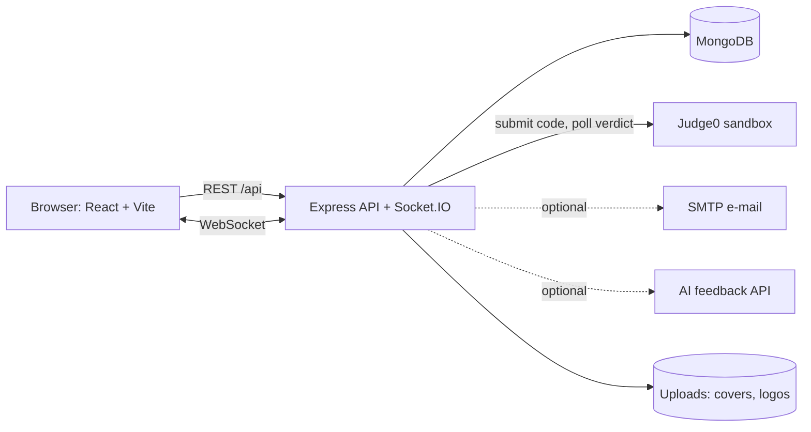
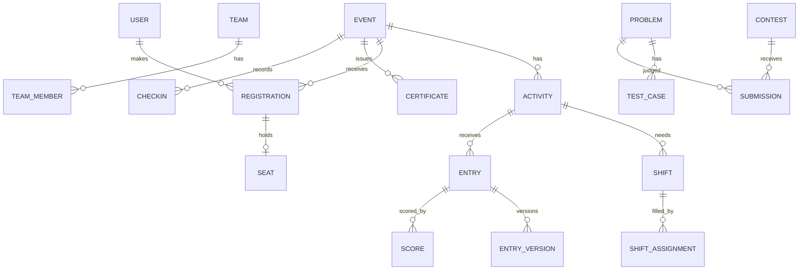

# PUB FestHub

### Campus Event, Competition and Coding Contest Operations Platform

**PUB CSE Fest-26 Hackathon 2026** · Pundra University of Science & Technology, Department of CSE

> ## 🎥 Demo Video (5–10 min): **[Watch the demo video](https://drive.google.com/drive/folders/1vf849QvULPuuyfNdtQ6hANtcbfkEuwcF?usp=sharing)**
>
> ## 🌐 Live Website: **[pub-csefest.netlify.app](https://pub-csefest.netlify.app/)**

| | |
|---|---|
| **Problem ID** | **C5** |
| **Problem title** | PUB FestHub: Campus Event, Competition and Coding Contest Operations Platform |
| **Track** | C: Smart Campus Services |
| **Team name** | **StackForge** |

---

## 👥 Team Members

| # | Name | Student ID | Role |
|---|------|-----------|------|
| 1 | Md Shoaib | 0322410105101051 | Team Leader |
| 2 | Md. Mohon Hossen Munna | 0322410105101024 | Backend Developer |
| 3 | Md Samiul Islam Shisir | 0322410105101001 | Frontend Developer |
| 4 | Md. Abu Hanif Akando | 03226105101004 | Video Editor |
| 5 | Sirajum Monira Oyshi | 03226205101093 | UI/UX Designer |

---

## 📑 Table of Contents

1. [About the Solution](#1-about-the-solution)
2. [Technology Stack](#2-technology-stack)
3. [Feature Status](#3-feature-status)
4. [Setup and Run Instructions](#4-setup-and-run-instructions)
5. [Environment File](#5-environment-file)
6. [Sample Login Accounts](#6-sample-login-accounts)
7. [Screenshots](#7-screenshots)
8. [Architecture and Database](#8-architecture-and-database)
9. [Security Highlights](#9-security-highlights)
10. [Deployed Link and Build](#10-deployed-link-and-build)
11. [Known Limitations](#11-known-limitations)
12. [Team Contribution](#12-team-contribution)
13. [Further Documentation](#13-further-documentation)

---

## 1. About the Solution

Department fests run seminars, competitions and programming contests with dozens of volunteers, and most coordination happens in chat groups and spreadsheets. **FestHub** is one platform that runs a fest from planning to results:

- **Events and registration:** activities, eligibility, deadlines, participant limits, individual and team registration, invitations, approval, cancellation and a FIFO waiting list.
- **Scheduling:** venue-clash and volunteer-overlap detection.
- **Volunteers and operations:** availability, shifts, coordinator-approved replacements, QR check-in, tasks, announcements, issue tracking and a readiness dashboard.
- **Judging:** versioned entries, judge assignment, rubric scoring and organiser-approved results.
- **Programming contests:** problem bank with hidden test cases, ICPC-style scoring, live scoreboard with freeze, practice mode, editorials and topic-wise progress. Submitted code runs in **Judge0** (isolated sandbox), **never on our server**.
- **Beyond the minimum:** certificates with QR verification, plagiarism detection, AI-assisted code feedback, auto-ranking leaderboard, command center, notification center, achievements portfolio and audit log.

---

## 2. Technology Stack

| Layer | Technology |
|---|---|
| Frontend | React 18, TypeScript, Vite, Tailwind CSS, React Router, TanStack Query |
| Backend | Node.js 20+, Express, TypeScript |
| Database | MongoDB with Mongoose |
| Real-time | Socket.IO (live notifications, scoreboard) |
| Code judging | Judge0 (self-hosted via Docker or hosted API) |
| Auth | JWT access token and rotating refresh token (httpOnly cookie), bcrypt, role-based access control |
| Validation | Zod (shared between server and web) |
| PDF / QR | PDFKit, QR codes |
| Testing / quality | Vitest, Supertest, Testing Library, ESLint, Prettier |
| DevOps | Docker Compose (web + API + MongoDB + Judge0), nginx |

Monorepo (npm workspaces): `apps/server`, `apps/web`, `packages/shared`.

---

## 3. Feature Status

### Required features

| # | Required feature | Status | Where to find it |
|---|---|---|---|
| 1 | Create events with activities (seminar, workshop, competition), eligibility, registration deadline, participant limit, venue | ✅ Done | Events → New event |
| 2 | Individual and team registration with invitations, approval, cancellation, waiting list | ✅ Done | Events → open an event → Register |
| 3 | Schedule activities and rounds; flag venue clashes and overlapping volunteer duties | ✅ Done | Manage event → Schedule |
| 4 | Judging: versioned entries, judge assignment, rubric scores, organiser-approved results | ✅ Done | Judging, Manage event → Results |
| 5 | Volunteer availability, duty and shift assignment, coordinator-approved replacement | ✅ Done | Volunteer desk, Manage event → Shifts |
| 6 | QR check-in for participants, volunteer attendance and task completion | ✅ Done | QR check-in (camera scan and manual code) |
| 7 | Announcements, issue tracking with owner and resolution, readiness view | ✅ Done | Manage event → Announcements / Issues / Readiness |
| 8 | Problem bank (statements, constraints, samples, hidden tests); contests with start/end and ICPC scoring | ✅ Done | Problem setting, Contests |
| 9 | Judged in isolated sandbox with time and memory limits; verdicts AC, WA, TLE, RE, CE; live scoreboard with freeze | ✅ Done | Contests (Judge0 sandbox) |
| 10 | Practice mode after contest, editorials after end, topic-wise progress per student | ✅ Done | Practice, Contest → Editorial |

### Additional features (beyond the minimum)

| Feature | Description |
|---|---|
| Role system + audit log | Admin, Organizer, Coordinator, Participant, Volunteer, Judge, enforced on the server; searchable audit trail of sensitive actions |
| Role requests | Users can request Judge or Coordinator roles; admins approve or reject with a reason |
| Notification center | In-app bell and page, live over Socket.IO, optional e-mail copy via SMTP |
| Team invites | Invite by e-mail, invite link and join code for both event teams and contest teams (14-day expiry) |
| Certificates | Customisable template editor with live preview, bulk or manual issue, PDF with QR, revoke / reissue, public verification at `/verify/:id`, team certificates |
| Plagiarism detection | Token-based winnowing engine, side-by-side comparison, suspicious / confirmed / clear review |
| AI code feedback | Rubric-based feedback drafts reviewed by staff before being published (optional, needs API key; manual feedback always works) |
| Auto-ranking leaderboard | Judge score + AI score + plagiarism penalty with deterministic tie-breaks; CSV/PDF export |
| Command center | Live organiser dashboard: registrations, submissions, certificates |
| My achievements | Participant certificates, results, feedback and downloadable portfolio PDF |
| Venue manager | Venues with capacity; clash detection uses them |
| Dark mode + exports | Theme toggle; CSV and PDF export on list pages |

---

## 4. Setup and Run Instructions

**Requirements:** Node.js ≥ 20, npm, MongoDB (local, Docker or Atlas). Docker Desktop is needed for self-hosted Judge0.

### Option A: Local development

```bash
# 1. Clone and install (installs all workspaces)
git clone <YOUR_REPOSITORY_URL>
cd festhub
npm install

# 2. Start MongoDB (skip if you already have one)
docker run -d --name festhub-mongo -p 27017:27017 mongo:7

# 3. Configure environment
cp .env.example apps/server/.env        # then edit the secrets (see section 5)
cp apps/web/.env.example apps/web/.env  # defaults are fine for local dev

# 4. Run migrations (also run automatically on server start)
npm run migrate

# 5. Seed demo data (WIPES the database, then creates accounts and sample data)
npm run seed -- --reset
#    On an existing database, only add what is missing:
#    npm run seed:demo

# 6. Run server (http://localhost:5000) and web (http://localhost:5173)
npm run dev
```

### Option B: Docker (web + API + MongoDB + Judge0)

```bash
cp docker.env.example .env      # set JWT_ACCESS_SECRET and QR_TOKEN_SECRET
docker compose up -d --build    # web: http://localhost:8080
docker compose --profile tools run --rm seed
```

### Judge0 for programming contests

The contest judge needs a Judge0 instance. `docker compose up -d` starts a self-hosted one on port 2358 (Linux or WSL2 recommended).

```bash
curl http://localhost:2358/languages      # should list languages
node scripts/judge-smoke.mjs              # expected verdicts: AC, WA, CE, TLE, RE
```

If you cannot run Judge0, set `JUDGE_ADAPTER=mock` in the server `.env`. This gives **labelled fake verdicts for UI demos only** and does not execute code. See `docs/JUDGE0.md` and `docs/LOCAL_JUDGE0_BN.md`.

### Tests, quality and production build

```bash
npm run typecheck && npm run lint
npm test                                  # server DB tests need MongoDB at TEST_MONGODB_URI (that DB is dropped)
npm run build                             # production build
npm run start -w @festhub/server          # run production server
```

---

## 5. Environment File

Copy `.env.example` to `apps/server/.env` (Docker: `docker.env.example` to `.env`). **Never commit `.env` files.**

```env
NODE_ENV=development
PORT=5000

# Database
MONGODB_URI=mongodb://127.0.0.1:27017/festhub
TEST_MONGODB_URI=mongodb://127.0.0.1:27017/festhub_test

# Secrets: generate with
# node -e "console.log(require('crypto').randomBytes(48).toString('hex'))"
JWT_ACCESS_SECRET=change-me
QR_TOKEN_SECRET=change-me-too
QR_TOKEN_TTL_SEC=45

# CORS / cookies
CLIENT_ORIGIN=http://localhost:5173

# Judge0 / contests (judge0 = real judging, mock = UI demo only)
JUDGE_ADAPTER=judge0
JUDGE0_BASE_URL=http://localhost:2358
SUBMISSION_COOLDOWN_SEC=10

# Optional: e-mail notifications (leave SMTP_HOST empty to disable)
# SMTP_HOST=
# Optional: AI code feedback (leave empty to disable)
# ANTHROPIC_API_KEY=
# ANTHROPIC_MODEL=
```

| Variable | Required | Purpose |
|---|---|---|
| `MONGODB_URI` | Yes | Main database |
| `JWT_ACCESS_SECRET`, `QR_TOKEN_SECRET` | Yes | Signing secrets for login tokens and check-in QR codes |
| `CLIENT_ORIGIN` | Yes | CORS allow-list and cookie origin |
| `JUDGE_ADAPTER`, `JUDGE0_*` | For contests | Judge0 endpoint settings |
| `SMTP_*` | Optional | E-mail copy of notifications |
| `ANTHROPIC_*` | Optional | AI code feedback; the app works fully without it |

---

## 6. Sample Login Accounts

After `npm run seed -- --reset`. **Password for all demo accounts: `Demo@12345`**

| Role | Email | What to try |
|---|---|---|
| Admin | `demo.admin@festhub.test` | Users and roles, audit log, role requests |
| Organizer | `demo.organiser@festhub.test` | Events, venues, schedule, results, certificates, leaderboard, command center |
| Coordinator | `demo.coordinator@festhub.test` | Volunteer shifts, replacements, check-in, issues |
| Judge | `demo.judge@festhub.test` (also `demo.judge2@festhub.test`) | Judging, problem setting, plagiarism, code feedback |
| Participant | `demo.participant@festhub.test` | Register, submit entries, contests, achievements |
| Participant (with scored work) | `demo.student1@festhub.test` … `demo.student6@festhub.test` | Team certificates, leaderboard, feedback |
| Volunteer | `demo.volunteer@festhub.test` | Take shifts, QR check-in desk |

The classic seed also creates `admin@`, `organiser@`, `coordinator@`, `judge@`, `judge2@`, `volunteer1@`–`volunteer3@`, `participant1@`–`participant6@` (all `@festhub.test`, password `Password123`).

---

## 7. Architecture and Database

### System architecture



Server layering: `route → validation (zod) → auth → role/ownership check → service (business rules) → model`.

```
apps/server/src  config · models · routes · services · middleware · sockets · seed · tests
apps/web/src     api · components · hooks · lib · pages
packages/shared  roles, enums, zod schemas and pure logic shared by both apps
```

### Core data model (simplified)



Main collections: `User, RefreshToken, RoleRequest, Event, Activity, Registration, Seat, Team, TeamMember, Invitation, Notification, Availability, Shift, ShiftAssignment, CheckInToken, CheckIn, Entry, EntryVersion, JudgeAssignment, Score, Certificate, CertificateTemplate, AuditLog, Problem, TestCase, Contest, ContestRegistration, ContestTeam, Submission, CodeSubmission, PlagiarismPair, Feedback, ReviewRubric, LeaderboardSetting`. Full design: `docs/DATABASE_DESIGN.md` and `docs/ARCHITECTURE.md`.

**Key design decisions**
- **Seats are rows, not counters.** A unique index on `(eventId, seatNo)` guarantees capacity can never be exceeded, even under concurrent registration. Cancelled seats pass to the first waitlisted person (FIFO).
- **Scoreboard is recomputed server-side** from submission rows (ICPC rules: solved ↓, penalty ↑, last accepted time ↑; 20-minute penalty per wrong attempt; CE does not count).
- **Hidden test cases** live in a separate collection that is never selected by participant queries.

---

## 8. Security Highlights

- Server-enforced role-based access control; frontend route guards are for UX only.
- Passwords hashed with bcrypt; JWT access token plus rotating refresh token in an httpOnly cookie; login and submission rate limiting; Helmet and a CORS allow-list.
- Zod validation on all inputs; invalid input returns clear errors.
- Check-in QR tokens are signed, short-lived (45 s by default), revocable and one-use per person.
- **Submitted code never runs on the application server**; it is sent to the Judge0 sandbox with time and memory limits.
- Hidden test data is never exposed to participants; judges can only access assigned entries.
- Audit log of sensitive actions (role changes, deletions, revocations, configuration).
- Only simulated or synthetic data is used. No real money or personal data.

---

## 9. Deployed Link and Build

- **Live website:** https://pub-csefest.netlify.app/
- **Demo video:** https://drive.google.com/drive/folders/1vf849QvULPuuyfNdtQ6hANtcbfkEuwcF?usp=sharing
- For evaluation we also provide the full **local setup** above (internet access may be unreliable on the evaluation day).

---

## 10. Known Limitations

- PDFs (certificates, reports) use standard Latin-1 fonts, so **Bangla characters print as `?`**. Use English spellings of names on certificates. A Unicode font (e.g. Noto Sans Bengali) can be registered in `certificatePdf.ts` / `brandedPdf.ts`.
- Roles are global, not per event (a coordinator can manage any event).
- The judge queue is in-process (single API instance); it is re-queued on restart.
- Some list pages are not paginated (limits of 50–500 records).
- Team invites match the e-mail typed at registration; e-mail ownership is not verified.
- AI feedback is optional and disabled unless `ANTHROPIC_*` is configured.
- Self-hosted Judge0 needs Docker with privileged mode (Linux or WSL2); on some newer Docker/WSL2 versions a cgroup v1 setting is required (see `docs/LOCAL_JUDGE0_BN.md`).

---

## 11. Team Contribution

| Member | Role | Contribution |
|---|---|---|
| **Md Shoaib** | Team Leader | Project planning and coordination, system integration, authentication / RBAC, deployment, final testing |
| **Md. Mohon Hossen Munna** | Backend Developer | REST API, MongoDB models, registration and waiting-list logic, clash detection, judging flow, Judge0 adapter, scoring and scoreboard |
| **Md Samiul Islam Shisir** | Frontend Developer | React pages and components, role dashboards, forms, QR check-in UI, contest and scoreboard UI |
| **Md. Abu Hanif Akando** | Video Editor | Demo video recording, editing and presentation |
| **Sirajum Monira Oyshi** | UI/UX Designer | Interface design, layouts, colour and branding, dark mode, usability |

Every member can explain the design, code and decisions of the project.

---

## 12. Further Documentation

| Document | Content |
|---|---|
| `docs/ARCHITECTURE.md` | Architecture, auth, clash detection, registration, judging, contest design |
| `docs/DATABASE_DESIGN.md` | Collections, indexes, consistency rules |
| `docs/API_CONTRACT.md` | REST endpoints |
| `docs/JUDGE0.md`, `docs/LOCAL_JUDGE0_BN.md` | Judge0 setup (English and Bangla) |
| `docs/REQUIREMENTS_MATRIX.md` | Requirement-by-requirement evidence |
| `docs/DEMO_SCRIPT.md` | Suggested live demo order |
| `docs/DEPLOYMENT.md` | Deployment notes |
| `PROGRESS.md`, `CHANGELOG.md` | Staged build log and history |

---

<p align="center"><b>Team StackForge</b> · PUB CSE Fest-26 Hackathon · Pundra University of Science & Technology</p>
